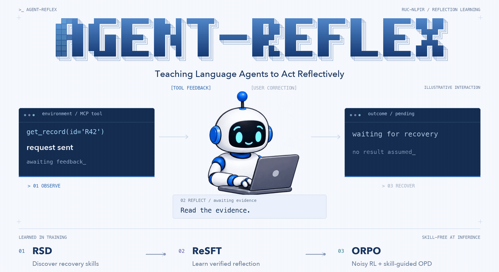
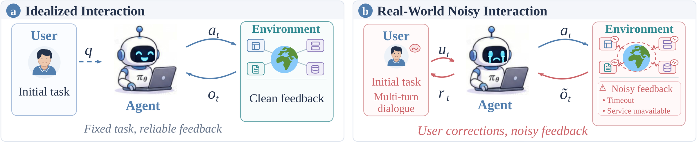
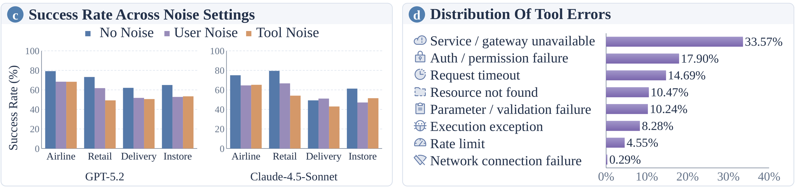
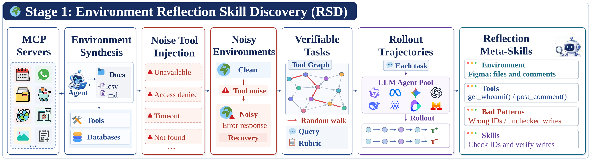
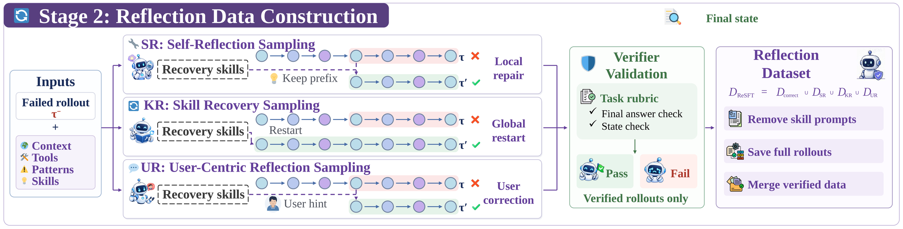
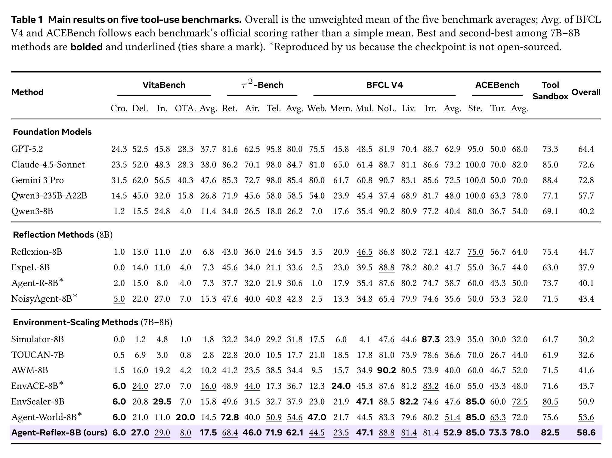
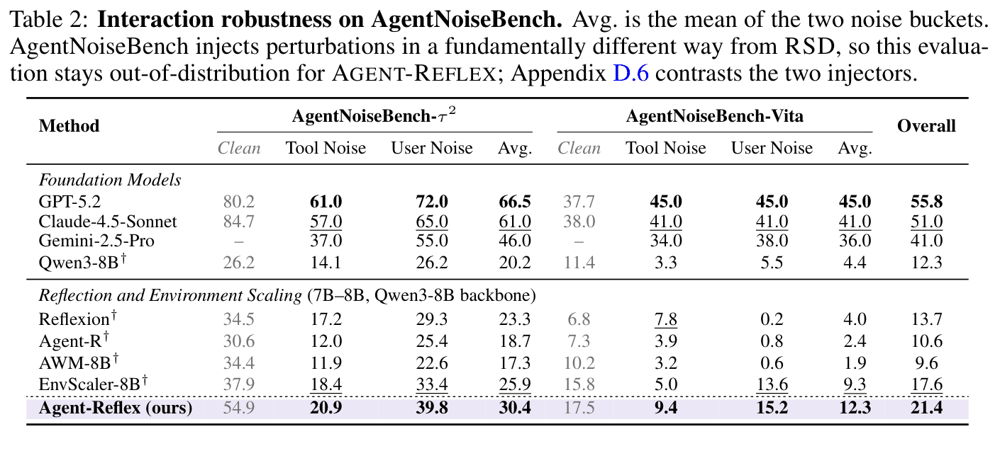
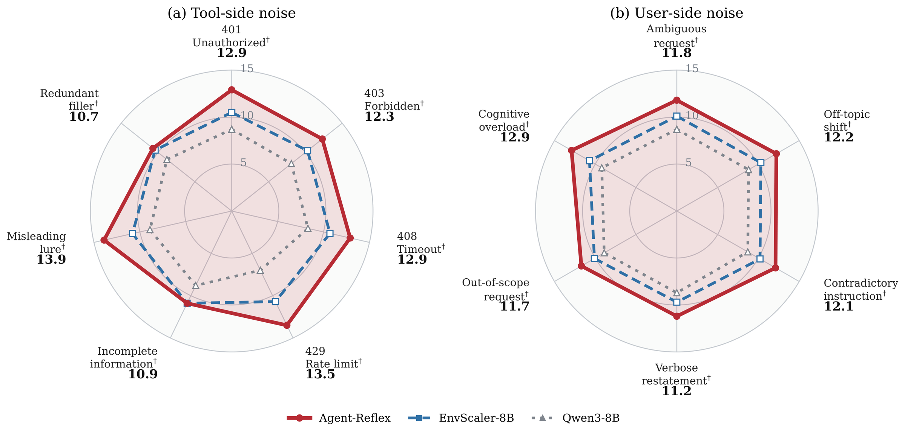
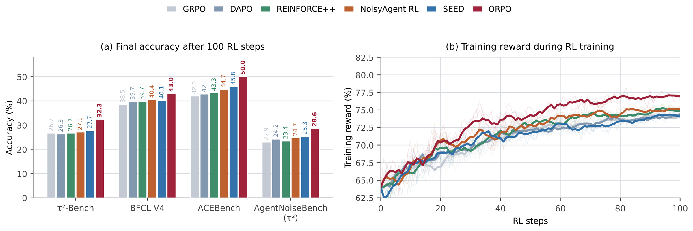

<div align="center">



<h1>&nbsp;Agent-Reflex: Teaching Language Agents to Act Reflectively</h1>

##### If you like our project, please give us a star ⭐ on GitHub for the latest update.

[](https://arxiv.org/abs/XXXX.XXXXX)
[](https://huggingface.co/dongguanting/Agent-Reflex-8B)
[](https://huggingface.co/datasets/dongguanting/Agent-Reflex-SFT-54K)
[](https://huggingface.co/datasets/dongguanting/Agent-Reflex-RL-2K)
[](RSD)
[](LICENSE)

*A training framework that elicits **proactive reflection** in tool-using LLM agents: noticing noisy tool feedback and user corrections, and recovering from them.*

[Demo](#-demo) · [Overview](#-overview) · [Framework](#-agent-reflex-framework) · [Results](#-benchmarks--results) · [Installation](#-installation) · [Data](#-data) · [Quick Start](#-quick-start) · [Citation](#-citation)

</div>

## 📣 News

* **[2026-10]** 🤗 The **ReSFT data (54,663 trajectories)** and **ORPO tasks (2,550 with skills)** are now available on Hugging Face: [SFT-54K](https://huggingface.co/datasets/dongguanting/Agent-Reflex-SFT-54K) · [RL-2K](https://huggingface.co/datasets/dongguanting/Agent-Reflex-RL-2K).
* **[2026-10]** 🤗 The **[Agent-Reflex-8B](https://huggingface.co/dongguanting/Agent-Reflex-8B)** checkpoint (Qwen3-8B, ReSFT + ORPO) is released.
* **[2026-10]** 🚀 Full codebase released: the RSD skill library (1,170 meta-skills), ReSFT and ORPO training recipes, and evaluation on six benchmarks.
* **[2026-10]** 📄 Our paper **Agent-Reflex: Teaching Language Agents to Act Reflectively** is now available on [arXiv](https://arxiv.org/abs/XXXX.XXXXX).

## 🎬 Demo

### User-Centric Reflection on a Noisy MCP Task

https://github.com/user-attachments/assets/8c73de1c-7767-4e9d-823f-fa68a3a87620

<p align="center"><sub>🎥 <a href="assets/demo/demo.mp4">Download the 1080p video</a> · 💻 <a href="assets/demo/index.html">interactive replay</a> (open locally in a browser)</sub></p>

## 💡 Overview

**Agents are trained in idealized environments but deployed into noisy ones.** Two gaps follow:

* **(1) No noisy feedback.** Real MCP tools time out, reject permissions or return malformed results, yet training environments return clean feedback, so agents never learn to detect and recover from failures.
* **(2) No user correction.** Real users interrupt and correct the agent mid-task, yet user simulators rarely issue such corrections.

<p align="center"><b>Figure 1 (a, b) · The two gaps.</b> Idealized interaction (a) vs. real-world interaction with user corrections and noisy feedback (b).</p>
<p align="center"></p>

<p align="center"><b>Figure 1 (c, d) · The cost of noise.</b> Strong agents lose success rate under user or tool noise (c); tool errors fall into eight recurring families (d).</p>
<p align="center"></p>

**Agent-Reflex** treats reflection as a learnable meta-skill: it mines skills from failures in noisy environments, distills them into supervised data and reinforces them with noisy agentic RL. On Qwen3-8B it improves six agent benchmarks and stays robust under noise.

## ✨ Agent-Reflex Framework

### Stage 1 · Environment Reflection Skill Discovery (RSD)

Build failure-aware executable environments by perturbing tool returns with real-world failure families, and mine verifier-matched success / failure pairs into an offline library of **1,170 reflection meta-skills** over **557 environments**. Environment synthesis and the environment infrastructure follow [Agent-World](https://github.com/RUC-NLPIR/Agent-World).

<p align="center"></p>

### Stage 2 · Reflective Supervised Fine-Tuning (ReSFT)

Convert each skill into verifier-validated **self-reflection (SR)**, **skill recovery (KR)** and **user-correction (UR)** data, with skill prompts stripped, and internalize them by supervised fine-tuning.

<p align="center"></p>

### Stage 3 · On-Policy Reflective Policy Optimization (ORPO)

Combine Noisy Agent RL with same-token, skill-guided on-policy distillation (OPD) to provide dense reflection supervision. Skills are used only in training; the deployed agent is skill-free.

<p align="center"></p>

## 📊 Benchmarks & Results

We evaluate on six agent benchmarks under each benchmark's official metric:

* **General Function Calling:**
  * [BFCL V4](https://gorilla.cs.berkeley.edu/leaderboard.html) ([paper](https://proceedings.mlr.press/v267/patil25a.html)): the Berkeley Function Calling Leaderboard extended to agentic evaluation (web search, memory, multi-turn, live / non-live, irrelevance); 5,217 tasks.
  * [ACEBench](https://arxiv.org/abs/2501.12851): normal, special and agentic tool use, emphasizing when to call a tool and how to handle underspecified requests.
  * [ToolSandbox](https://arxiv.org/abs/2408.04682): stateful, conversational tool use with implicit state dependencies, an LLM user simulator and deliberately unsolvable tasks; 200 offline scenarios.
* **Long-Horizon Interactive Workflows:**
  * [τ²-Bench](https://arxiv.org/abs/2506.07982): dual-control airline, retail and telecom domains where agent and user both act on shared state under a policy document.
  * [VitaBench](https://arxiv.org/abs/2509.26490): delivery, in-store and OTA domains plus cross-scenario tasks spanning domains within one episode.
* **Noisy Interaction:**
  * [AgentNoiseBench](https://arxiv.org/abs/2602.11348): tool-side and user-side perturbations injected into τ²-Bench and VitaBench environments.

On Qwen3-8B, Agent-Reflex reaches **58.6** Overall on the five long-horizon tool-use benchmarks (+18.4 over the backbone, +7.7 over EnvScaler-8B) and **29.1** on AgentNoiseBench, the best among all 8B methods:

| Method | VitaBench | τ²-Bench | BFCL V4 | ACEBench | ToolSandbox | **Overall** | AgentNoiseBench |
| --- | :---: | :---: | :---: | :---: | :---: | :---: | :---: |
| Qwen3-8B | 11.4 | 26.2 | 40.4 | 54.0 | 69.1 | 40.2 | 12.3 |
| Reflexion | 6.8 | 34.5 | 42.7 | 64.0 | 75.4 | 44.7 | 13.7 |
| EnvScaler-8B | 15.8 | 37.9 | 47.6 | 72.5 | 80.5 | 50.9 | 18.2 |
| Agent-World-8B | 14.5 | 54.6 | 51.4 | 72.0 | 75.6 | 53.6 | – |
| **Agent-Reflex** | **17.5** | **62.1** | **52.9** | **78.0** | **82.5** | **58.6** | **29.1** |

<details>
<summary><b>Full tables, noise robustness and the RL algorithm comparison</b></summary>

<p align="center"></p>
<p align="center"></p>
<p align="center"></p>
<p align="center"></p>

</details>

## 🔧 Installation

### Environment Setup

Each part has its own environment, built by one script with [uv](https://github.com/astral-sh/uv) (`pip install uv`) from a pinned `requirements.txt`:

| Part | Python | Core packages | Setup |
| --- | :---: | --- | --- |
| ReSFT | 3.12 | torch 2.6.0 (cu124), transformers 5.8, DeepSpeed 0.19, flash-attn 2.7.4, Liger 0.8 | `bash LLaMA-Factory/setup_env.sh` |
| ORPO | 3.10 | torch 2.7.1 (cu128), verl 0.5, SGLang 0.4.10.post2, transformers 4.54.1, Ray 2.57, flash-attn 2.8.3 | `bash ORPO/setup_env.sh` |
| Model serving | 3.12 | vLLM 0.27.1 | `bash evaluation/shared/setup_vllm.sh` |
| Benchmarks | 3.10 / 3.12 | one venv per benchmark; upstream code cloned at pinned commits | `bash evaluation/<Bench>/setup.sh` |

* **Hardware**: NVIDIA 80 GB GPUs with a driver supporting CUDA 12.8. ReSFT uses 2 × 8 GPUs; ORPO and evaluation use 1 × 8.
* **Network**: the setup scripts need GitHub, PyPI and Hugging Face. Behind a proxy, export `HTTP_PROXY` / `HTTPS_PROXY` first.

### API Configuration

Training needs no API keys. Evaluation reads them from `evaluation/.env` (git-ignored):

```bash
cp evaluation/.env.example evaluation/.env
# then edit evaluation/.env:
BOYUE_API_KEY=sk-xxxxxxxx
BOYUE_API_BASE_URL=http://35.220.164.252:3888/v1   # outside CN/HK: https://api.boyuerichdata.opensphereai.com/v1
SERPER_API_KEY=xxxxxxxx
```

* `BOYUE_API_KEY`: the user simulator (`gpt-4.1`) and judge (`claude-sonnet-4-6`) for every benchmark except BFCL. Register at [Boyue API](https://api.boyuerichdata.opensphereai.com) ([docs](https://boyuerichdata.apifox.cn/)), open the **API令牌 (API tokens)** page and create a token in the `auto` group; the key starts with `sk-`.

> [!NOTE]
> By default our evaluation calls these models through Boyue, a third-party OpenAI-compatible API service. Any OpenAI-compatible endpoint works: to use the official OpenAI / Anthropic APIs or your own gateway, point the base URL and key in `evaluation/.env` (and the client setup in each benchmark's `run.sh` / config) to your provider. A coding agent can make this change in a few minutes.
* `SERPER_API_KEY`: BFCL V4 web search only, from [serper.dev](https://serper.dev).

## 🗂️ Repository

```
Agent-Reflex/
├── RSD/             🪞 Stage 1 · the reflection meta-skill library (1,170 skills)
├── LLaMA-Factory/   📘 Stage 2 · ReSFT recipe and launch scripts
├── ORPO/            🎯 Stage 3 · verl-based ORPO: noisy rollouts + skill-guided OPD
├── evaluation/      📊 τ²-Bench, BFCL V4, ACEBench, VitaBench, AgentNoiseBench, ToolSandbox
└── assets/          🖼️ figures used in this README; demo/ holds the demo video and replay page
```

| Folder | What you get | Start here |
| --- | --- | --- |
| [`RSD/`](RSD) | 557 MCP-anchored environments with tools, bad patterns and 1,170 reflection meta-skills, in English and Chinese | [README](RSD/README.md) |
| [`LLaMA-Factory/`](LLaMA-Factory) | ReSFT on Qwen3-8B: full fine-tuning, ZeRO-3, 3 epochs, 5,127 steps | [README](LLaMA-Factory/README.md) · [reproduce](LLaMA-Factory/reproduce_skills.md) |
| [`ORPO/`](ORPO) | ORPO from the ReSFT checkpoint on 1 × 8 GPUs | [README](ORPO/README.md) · [reproduce](ORPO/reproduce_skills.md) |
| [`evaluation/`](evaluation) | one folder per benchmark, official settings, vLLM serving | [README](evaluation/README.md) · [reproduce](evaluation/reproduce_skills.md) |

## 📦 Data

| **Resource** | **Size** | **Download** | **Put it at** |
| --- | --- | --- | --- |
| Agent-Reflex-8B (Qwen3-8B, ReSFT + ORPO) | 16 GB | [🤗 HuggingFace](https://huggingface.co/dongguanting/Agent-Reflex-8B) | any path, pass as `MODEL_PATH` |
| ReSFT data, 54,663 trajectories | 2.6 GB | [🤗 HuggingFace](https://huggingface.co/datasets/dongguanting/Agent-Reflex-SFT-54K) | `LLaMA-Factory/data/agent_reflex_resft/train/` |
| ORPO tasks, 2,550 with skills | 152 MB | [🤗 HuggingFace](https://huggingface.co/datasets/dongguanting/Agent-Reflex-RL-2K) | `ORPO/data/` |
| RSD skill library, 1,170 skills (English / Chinese) | 22 MB | this repo | [`RSD/environment_skills.jsonl`](RSD) · [`RSD/environment_skills_zh.jsonl`](RSD) |
| Evaluation data | 115 MB | this repo | `evaluation/<Bench>/data/` |

```bash
pip install -U huggingface_hub
hf download dongguanting/Agent-Reflex-SFT-54K --repo-type dataset --include "train/*" \
  --local-dir LLaMA-Factory/data/agent_reflex_resft
hf download dongguanting/Agent-Reflex-RL-2K train_envscaler_2550_with_skills.jsonl \
  --repo-type dataset --local-dir ORPO/data
hf download dongguanting/Agent-Reflex-8B --local-dir /path/to/Agent-Reflex-8B
```

## 🚀 Quick Start

### 1. ReSFT

```bash
cd LLaMA-Factory
NNODES=2 NODE_RANK=<0|1> MASTER_ADDR=<node0> MODEL_PATH=/path/to/Qwen3-8B \
  bash scripts/run_resft_qwen3_8b.sh
```

### 2. ORPO

Start from the ReSFT model checkpoint:

```bash
cd ORPO
python scripts/prepare_init_checkpoint.py /path/to/resft_checkpoint --apply
MODEL_PATH=/path/to/resft_checkpoint bash scripts/run_orpo_qwen3_8b.sh
```

### 3. Evaluation

Full task sets under the official settings (fill in `evaluation/.env` first):

```bash
cd evaluation
MODEL_PATH=/path/to/Agent-Reflex-8B RUN_NAME=agent-reflex bash run_all.sh
```

`run_all.sh` serves the model with vLLM and runs all six benchmarks; set `BENCHES="Tau2 BFCL-v4"` to run a subset. Per-benchmark details are in [`evaluation/README.md`](evaluation/README.md).

## 🙏 Acknowledgements

Agent-Reflex builds on [verl](https://github.com/volcengine/verl), [LLaMA-Factory](https://github.com/hiyouga/LLaMA-Factory), [EnvScaler](https://github.com/RUC-NLPIR/EnvScaler), [Agent-World](https://github.com/RUC-NLPIR/Agent-World), [tau2-bench](https://github.com/sierra-research/tau2-bench), [BFCL](https://github.com/ShishirPatil/gorilla), [VitaBench](https://github.com/meituan-longcat/vitabench), [ToolSandbox](https://github.com/apple/ToolSandbox) and [AgentNoiseBench](https://arxiv.org/abs/2602.11348). Thanks to their authors.

## 📄 License

Agent-Reflex code and the RSD skill library are released under the [MIT License](LICENSE). Vendored components keep their own licenses:

| Component | License |
| --- | --- |
| `ORPO/` (verl), `LLaMA-Factory/` | Apache-2.0 |
| `evaluation/BFCL-v4/` (BFCL data, from [gorilla](https://github.com/ShishirPatil/gorilla)) | Apache-2.0 |
| `evaluation/Tau2/data/`, `evaluation/AgentNoiseBench/repo/tau2-bench-main/` ([tau2-bench](https://github.com/sierra-research/tau2-bench)) | MIT |
| `evaluation/VitaBench/data/`, `evaluation/AgentNoiseBench/repo/vitabench/` ([VitaBench](https://github.com/meituan-longcat/vitabench)) | MIT |
| `evaluation/ACEBench/interact_with_env/` ([EnvScaler](https://github.com/RUC-NLPIR/EnvScaler), [tau-bench](https://github.com/sierra-research/tau-bench)) | MIT |

ToolSandbox is cloned from [apple/ToolSandbox](https://github.com/apple/ToolSandbox) at setup time and is not redistributed here. The AgentNoiseBench noise injection and data follow [AgentNoiseBench](https://arxiv.org/abs/2602.11348); please refer to its authors for terms of use.

## 📚 Citation

```bibtex
@article{dong2026agentreflex,
  title  = {Agent-Reflex: Teaching Language Agents to Act Reflectively},
  author = {Dong, Guanting and Yang, Xinyu and Jin, Jiajie and Hu, Yuyang and Song, Xiaoshuai and Chen, Yifei and Li, Xiaoxi and Tan, Jiejun and Zhu, Yutao and Chua, Tat-Seng and Wen, Ji-Rong and Dou, Zhicheng},
  journal = {arXiv preprint},
  year   = {2026}
}
```
